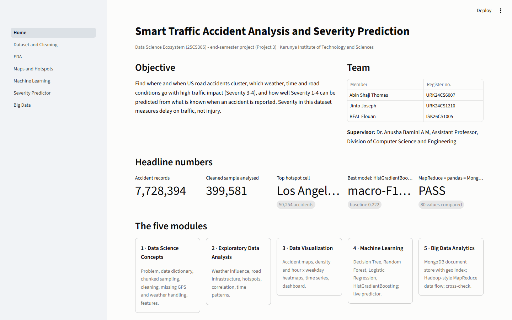
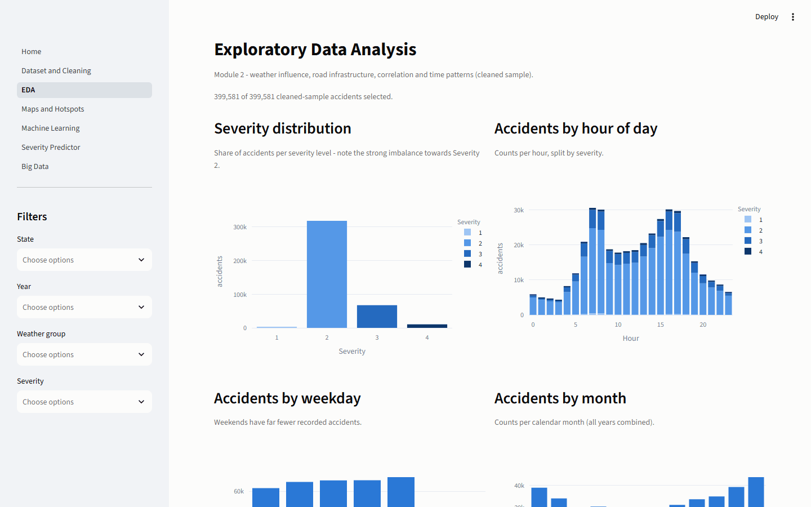
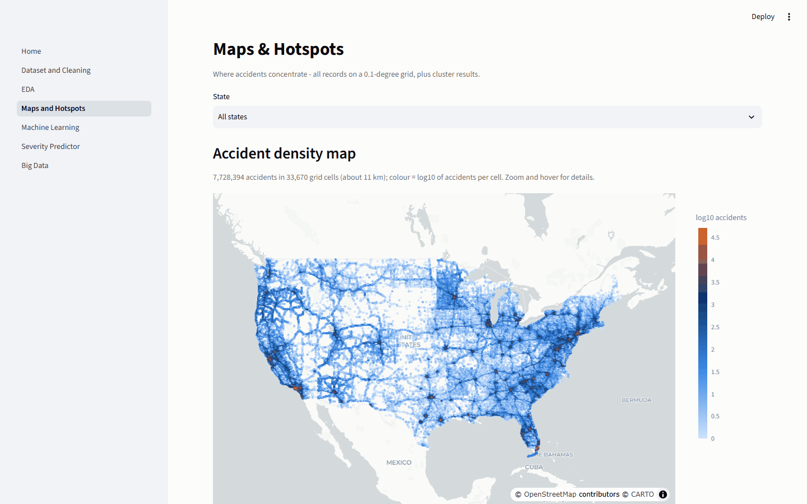
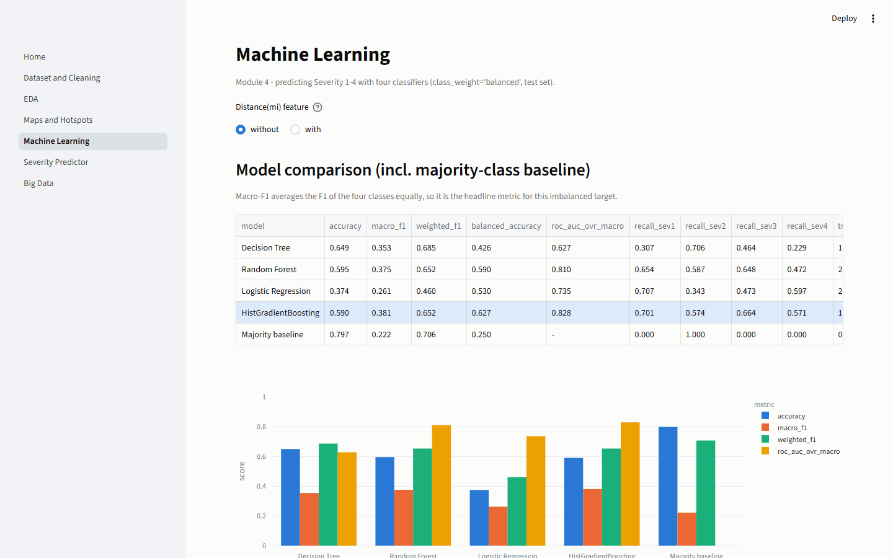
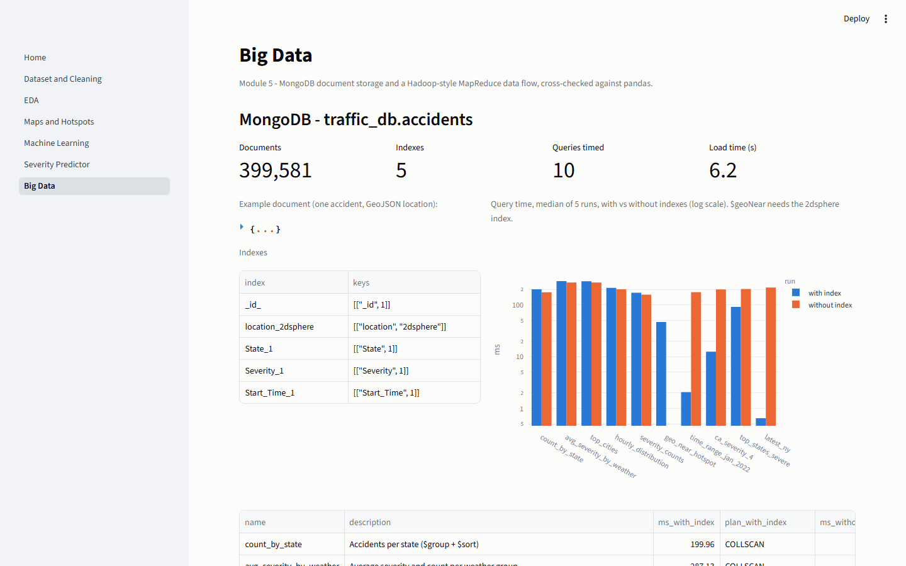

# Smart Traffic Accident Analysis and Severity Prediction

End-semester project (Project 3) for **Data Science Ecosystem (25CS305)**, Karunya Institute of Technology and Sciences.

**Team:** Abin Shaji Thomas (URK24CS6007), Jinto Joseph (URK24CS1210), BÉAL Elouan (ISK26CS1005)
**Supervisor:** Dr. Anusha Bamini A M, Assistant Professor, Division of Computer Science and Engineering

An end-to-end data-science project on the US Accidents dataset: chunked ingestion and cleaning of the multi-gigabyte raw CSV,
missing-GPS and weather handling, weather / infrastructure / hotspot / correlation / time analysis, maps and
heatmaps, four severity classifiers, MongoDB storage, a Hadoop-style MapReduce data flow, and a Streamlit dashboard
that shows everything.



## Problem

Traffic agencies need to know where and when accidents cluster, which conditions go with high-impact accidents,
and whether the impact of a new accident can be estimated from what is known when it is reported. In this dataset
`Severity` (1-4) measures the **impact on traffic** (length of the delay), not injury.

## Objectives

1. Clean the accident records and handle missing GPS and weather values.
2. Measure the influence of weather and road infrastructure on severity.
3. Identify spatial hotspots and time patterns; run correlation analysis.
4. Train and compare Decision Tree, Random Forest, Logistic Regression and HistGradientBoosting classifiers.
5. Store the data in MongoDB and reproduce key aggregations with a MapReduce data flow, cross-checked with pandas.
6. Present maps, heatmaps, time series and a dashboard.

## Dataset

**US Accidents (2016 - 2023)**, Sobhan Moosavi et al. - Kaggle: <https://www.kaggle.com/datasets/sobhanmoosavi/us-accidents>.
Licence **CC BY-NC-SA 4.0**; used here for non-commercial academic purposes only. Download `US_Accidents_March23.csv`
and place it in `data\raw\` (not committed). Only a 5,000-row cleaned sample (`data/sample/sample_5k.csv`) is
redistributed, under the same licence. Row counts, period and states are in the results below
(`reports/metrics/dataset_profile.json`).

## Modules

| # | Module | Notebook | Tasks |
|---|---|---|---|
| 1 | Data Science Concepts | [`01_data_science_concepts.ipynb`](notebooks/01_data_science_concepts.ipynb) | problem, data dictionary, lifecycle, chunked stratified sampling, **cleaning**, **missing GPS**, weather imputation, features |
| 2 | Exploratory Data Analysis | [`02_eda.ipynb`](notebooks/02_eda.ipynb) | missing values before/after, **weather influence** (chi-square, Kruskal-Wallis, Cramér's V), road infrastructure, **hotspots** (grid, KMeans, DBSCAN), **correlation**, time patterns |
| 3 | Data Visualization | [`03_data_visualization.ipynb`](notebooks/03_data_visualization.ipynb) | **accident maps**, **heatmaps**, **time-series plots**, weather charts, **dashboard** overview |
| 4 | Machine Learning | [`04_machine_learning.ipynb`](notebooks/04_machine_learning.ipynb) | **Decision Tree, Random Forest, Logistic Regression** + HistGradientBoosting, tuning, evaluation, importance |
| 5 | Big Data Analytics | [`05_big_data_analytics.ipynb`](notebooks/05_big_data_analytics.ipynb) | **MongoDB accident storage**, **Hadoop data flow (MapReduce)**, three-way cross-check |

## Folder structure

```
app/                     Streamlit dashboard (Home.py, pages/1-6, utils.py)
bigdata/
  mongodb/               load_to_mongo.py, queries.py
  hadoop_mapreduce/      mapper.py, reducer.py, export_input.py, run_pipeline.py, docker-compose.yml, hadoop.env, README.md
  spark_optional/        original PySpark jobs adapted to local paths (not executed)
data/
  raw/                   US_Accidents_March23.csv (not committed)
  processed/             Parquet sample, cleaned data, hotspot grid (generated, not committed)
  sample/sample_5k.csv   5,000 cleaned rows
docs/                    report_notes.md, screenshots/
models/best_model.joblib best pipeline (preprocessing + model)
notebooks/               01-05, committed with outputs
poster/                  A3 poster (.pptx, .pdf) and the scripts that build it
reports/                 figures/ (PNG), maps/ (HTML), metrics/ (every number, CSV/JSON)
scripts/                 profile_dataset.py, take_screenshots.py, update_readme_results.py, build_report_notes.py, check_consistency.py
src/                     utils, cleaning, features, analysis, modeling, train_final, bigdata_check, viz
tests/test_app.py        Streamlit AppTest smoke tests
```

## Setup (Windows PowerShell)

```powershell
python -m venv .venv
.\.venv\Scripts\python.exe -m pip install -r requirements.txt
# put US_Accidents_March23.csv in data\raw\
```

Run notebooks with `python -m nbconvert` from the venv (a bare `jupyter` command can pick up a system-wide Jupyter).

## How to run

```powershell
# dataset profile (rows, columns, period, states)
.\.venv\Scripts\python.exe scripts\profile_dataset.py

# Modules 1-4, in order (each writes data/processed and reports/)
.\.venv\Scripts\python.exe -m nbconvert --to notebook --execute --inplace --ExecutePreprocessor.timeout=-1 notebooks\01_data_science_concepts.ipynb
.\.venv\Scripts\python.exe -m nbconvert --to notebook --execute --inplace --ExecutePreprocessor.timeout=-1 notebooks\02_eda.ipynb
.\.venv\Scripts\python.exe -m nbconvert --to notebook --execute --inplace --ExecutePreprocessor.timeout=-1 notebooks\03_data_visualization.ipynb
.\.venv\Scripts\python.exe -m nbconvert --to notebook --execute --inplace --ExecutePreprocessor.timeout=-1 notebooks\04_machine_learning.ipynb

# rebuild only the final model from best_model.json
.\.venv\Scripts\python.exe -m src.train_final

# Module 5 - MongoDB must run on localhost:27017 (winget install MongoDB.Server; net start MongoDB)
.\.venv\Scripts\python.exe bigdata\mongodb\load_to_mongo.py
.\.venv\Scripts\python.exe bigdata\mongodb\queries.py
.\.venv\Scripts\python.exe bigdata\hadoop_mapreduce\run_pipeline.py
.\.venv\Scripts\python.exe -m src.bigdata_check
.\.venv\Scripts\python.exe -m nbconvert --to notebook --execute --inplace --ExecutePreprocessor.timeout=-1 notebooks\05_big_data_analytics.ipynb

# dashboard and tests
.\.venv\Scripts\activate
streamlit run app\Home.py
python -m pytest -q

# README results, report notes, consistency check, poster
python scripts\update_readme_results.py
python scripts\build_report_notes.py
python scripts\check_consistency.py
python poster\make_poster_figures.py
python poster\make_poster_facts.py
python poster\build_poster.py --template "poster\KGS_2026_-_Poster_Design_Template.pptx" --facts poster\poster_facts.json --root . --out poster\Accident_Poster_A3.pptx
powershell -ExecutionPolicy Bypass -File poster\export_pdf.ps1
```

The dashboard reads only saved files and works with MongoDB stopped; a missing file is reported with the command
that creates it.

## Results

<!-- RESULTS:START -->
*Generated by `scripts/update_readme_results.py` from `reports/metrics/` - do not edit by hand.*

**Data** (`dataset_profile.json`, `dataset_stats.json`, `cleaning_log.json`, `gps_missing.json`)

| Item | Value |
|---|---|
| Rows x columns (raw file) | 7,728,394 x 46 |
| Period | 2016-01-14 to 2023-03-31 |
| States | 49 |
| Stratified sample / after cleaning | 399,999 / 399,581 |
| Duplicates removed | 418 |
| Start GPS missing / recovered / dropped | 0 / 0 / 0 |
| End GPS imputed from Start | 176,088 (44.1%) |

**EDA highlights** (`eda_insights.json`, `weather_tests.json`, `hotspots.csv`)

* Weather: Rain has the highest severe share (22.87%) vs Fog/Haze the lowest (15.81%); overall 19.47%. The link is significant (chi-square p<1e-300) but weak (Cramer's V=0.039).
* Infrastructure: Severe share is highest near Junction (26.75% vs 18.9% without) and lowest near Crossing (7.04% vs 21.05%); strongest association: Crossing (V=0.120).
* Time: Peak hours are 07:00 and 16:00; a weekend day averages 53% fewer accidents than a weekday.
* Year: Severe share falls from 33.99% in 2016 to 2.83% in 2023 while counts rise - a change in data collection, so Year is not used as an ML feature.
* Hotspots: densest 0.1-degree cells - Los Angeles, CA (50,254), Miami, FL (42,955), Charlotte, NC (36,259), Baton Rouge, LA (33,612).

**Severity models - test set, WITHOUT Distance(mi) (headline)** (`model_comparison.csv`)

| Model | Accuracy | Macro-F1 | Weighted-F1 | ROC-AUC (OvR) | Recall Sev 3 | Recall Sev 4 |
|---|---|---|---|---|---|---|
| Decision Tree | 0.649 | 0.353 | 0.685 | 0.627 | 0.464 | 0.229 |
| Random Forest | 0.595 | 0.375 | 0.652 | 0.810 | 0.648 | 0.472 |
| Logistic Regression | 0.374 | 0.261 | 0.460 | 0.735 | 0.473 | 0.597 |
| HistGradientBoosting | 0.590 | 0.381 | 0.652 | 0.828 | 0.664 | 0.571 |
| Majority baseline | 0.797 | 0.222 | 0.706 | - | 0.000 | 0.000 |

Best model: **HistGradientBoosting** (highest macro-F1), 5-fold CV macro-F1 0.371 +/- 0.002. Every model's accuracy is below the majority baseline (0.797), so macro-F1 is the headline metric.
Top permutation-importance features: Start_Lng (0.0354), City (0.0282), Start_Lat (0.0276), State (0.0247), Month (0.0238).

<details><summary>With Distance(mi) (post-event, leakage - reported for honesty only)</summary>

| Model | Accuracy | Macro-F1 | Weighted-F1 | ROC-AUC (OvR) | Recall Sev 3 | Recall Sev 4 |
|---|---|---|---|---|---|---|
| Decision Tree | 0.703 | 0.414 | 0.732 | 0.684 | 0.592 | 0.303 |
| Random Forest | 0.631 | 0.421 | 0.688 | 0.872 | 0.739 | 0.688 |
| Logistic Regression | 0.390 | 0.273 | 0.474 | 0.750 | 0.513 | 0.614 |
| HistGradientBoosting | 0.640 | 0.431 | 0.698 | 0.887 | 0.761 | 0.729 |
| Majority baseline | 0.797 | 0.222 | 0.706 | - | 0.000 | 0.000 |

</details>

**Big data** (`mongo_results.json`, `mapreduce_counters.json`, `bigdata_crosscheck.json`)

* MongoDB: 399,581 documents, 5 indexes, 10 queries timed; indexed filters run 332x faster at best (latest_ny).
* MapReduce: 4 splits, 4 map tasks, 2 reduce tasks, 399,581 records per job.
* Cross-check MapReduce vs pandas vs MongoDB: accidents per state **PASS**, average severity per weather group **PASS**, accidents per hour **PASS** (80 values).
<!-- RESULTS:END -->

## Screenshots

| | |
|---|---|
|  |  |
|  |  |

Key figures: [dashboard overview](reports/figures/dashboard_overview.png) ·
[accident map](reports/maps/accident_map.html) · [severity heatmap](reports/maps/accident_heatmap.html) ·
[hotspot density](reports/figures/hotspot_density_heatmap.png) · [hour x weekday](reports/figures/heatmap_hour_weekday.png) ·
[time series](reports/figures/timeseries_monthly.png) · [correlation](reports/figures/correlation_heatmaps.png) ·
[weather](reports/figures/weather_severe_share.png) · [infrastructure](reports/figures/infrastructure_severe_share.png) ·
[ROC](reports/figures/roc_comparison.png) · [feature importance](reports/figures/feature_importance_top15.png) ·
[Hadoop data flow](reports/figures/hadoop_data_flow.png) · [project data flow](reports/figures/data_flow.png).
The full list of figures and tables is in [`docs/report_notes.md`](docs/report_notes.md).

## Tech stack

Python 3.14 · pandas, NumPy, PyArrow (Parquet), SciPy · scikit-learn · Matplotlib, Seaborn, Plotly, Folium ·
Streamlit · MongoDB 9 with pymongo (GeoJSON, 2dsphere) · Hadoop Streaming-style MapReduce (Python mapper/reducer;
optional Docker Hadoop 3.3.6, not executed) · optional PySpark (not executed) · python-pptx, Playwright · pytest.

## Limitations

* Severity is traffic impact, not injury; labels depend on the data provider and collection period (Year is excluded
  from the models for this reason).
* Counts are not rates - there is no traffic-volume data.
* Analysis and models use a stratified sample with a random (not time-based) split.
* `Distance(mi)` is known only after the accident, so the headline models exclude it.
* The real Hadoop cluster (HDFS/YARN in Docker) and the PySpark jobs were not executed: Docker is not installed and
  PySpark does not support Python 3.14.

## Acknowledgements

* **Original code base:** this project adapts
  [rit-vik/Accident-Severity-Prediction-and-Hotspot-Analysis-of-US-Road-Accidents-BDA-Project-](https://github.com/rit-vik/Accident-Severity-Prediction-and-Hotspot-Analysis-of-US-Road-Accidents-BDA-Project-)
  (commit `160ba7f`) by Ritvik Kar, Dhruv Abhijit Desai and Mithil S, released under the MIT licence. Reused and adapted:
  the ingestion/cleaning logic (column sanitising, duplicate removal, plausible-range limits, time features, weather
  grouping), the group-by analysis queries, the ML feature list, leakage rules, majority baseline, `metrics()` helper
  and the inverse-vs-sqrt class-weight comparison (re-expressed from PySpark/MLlib in pandas/scikit-learn), and the
  PySpark scripts in `bigdata/spark_optional/`. Every adapted file says so in its header. Everything else - GPS and
  weather handling, all statistics, hotspots, maps, the Decision Tree and HistGradientBoosting models, permutation
  importance, MongoDB, the MapReduce data flow and cross-check, the Streamlit app and the poster - was added in this
  project. No results, charts or screenshots from the original repository are included. See [`NOTICE.md`](NOTICE.md).
* **Dataset:** S. Moosavi, M. H. Samavatian, S. Parthasarathy, R. Ramnath, "A Countrywide Traffic Accident Dataset",
  arXiv:1906.05409, 2019; S. Moosavi et al., "Accident Risk Prediction based on Heterogeneous Sparse Data: New Dataset
  and Insights", ACM SIGSPATIAL 2019. CC BY-NC-SA 4.0.

## Licence

Code: MIT - see [`LICENSE`](LICENSE), which keeps the original copyright line. Data: CC BY-NC-SA 4.0.
